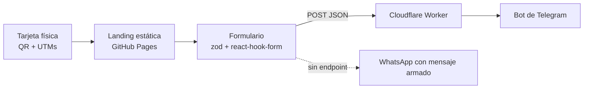

<h1 align="center">Williams Díaz Santander</h1>
<p align="center"><b>Ingeniero en Informática · Desarrollo de software a medida para empresas B2B</b></p>
<p align="center"><i>Sistemas web que automatizan tu operación y capturan clientes.</i></p>

<p align="center">
  <a href="https://digital.kyriosgrid.cl"><b>Ver sitio</b></a> ·
  <a href="https://digital.kyriosgrid.cl/#casos">Casos de éxito</a> ·
  <a href="https://digital.kyriosgrid.cl/#contacto">Solicitar diagnóstico</a> ·
  <a href="https://www.linkedin.com/in/williams-diaz-450749247">LinkedIn</a>
</p>

<p align="center">
  
  
  
  
  
  
</p>

---

## Qué hago por tu negocio

Un negocio B2B pierde ventas cuando las consultas llegan por canales dispersos, nadie las ve a tiempo y no se sabe qué canal trae clientes. Construyo los sistemas que cierran esa fuga:

| Servicio | Qué obtienes |
|---|---|
| **Web que convierte** | Sitio rápido, con SEO técnico y un camino claro hacia el contacto. Sabes qué canal trae clientes y cuánto cuesta cada consulta. |
| **Leads sin fuga** | Cada consulta queda registrada en base de datos y te avisa al instante por Telegram o WhatsApp. Respondes antes que la competencia. |
| **Cloud y seguridad** | Despliegues automatizados (CI/CD), autenticación bien hecha y revisión de cabeceras HTTP. Menos caídas y menos riesgo. |

## Resultados en proyectos reales

| Proyecto | Qué se hizo | Resultado |
|---|---|---|
| [**IVS Energy**](https://www.ivsenergy.cl/) · ingeniería SEC | Migración a generación estática con Next.js, SEO técnico (sitemap, JSON-LD, metadatos dinámicos), analítica con eventos personalizados y arquitectura de rutas por servicio y cobertura. | TTFB en móvil de **1,13 s a menos de 0,2 s**, Core Web Vitals en verde y **80 clics en Búsqueda de Google en 28 días**. |
| [**SINTEREC**](https://sinterec.cl) · sindicato de Claro Chile | Plataforma full-stack (Node.js/Express, React/Redux, PostgreSQL → MySQL) con autenticación JWT, roles, CI/CD y CDN. | Operación para **más de 1.000 usuarios activos**, cabeceras de seguridad con calificación **A+** en auditorías y migración a MySQL **sin pérdida de datos**. |
| [**Lubricentro Esquivel**](https://www.lubricentroesquivel.cl/) · servicio automotriz | Plataforma en Next.js 15 con PostgreSQL, seguimiento de leads y avisos automáticos por Telegram. | Cada oportunidad de venta queda registrada y notificada en tiempo real. |

## Cómo trabajamos

1. **Diagnóstico gratuito:** revisamos tu operación y tu sitio actual, e identificamos dónde se pierden consultas.
2. **Entrega por etapas:** primero lo de mayor impacto, en producción y medible, sin esperar un "gran lanzamiento".
3. **Medición y mejora:** cada contacto queda con su origen (tarjeta, Google, redes). La mejora es continua, con mantención y evolutivos.

No prometo cifras sin conocer tu operación: el diagnóstico sirve para estimarlas con tus propios datos.

## Seguridad como parte del trabajo

En 2024 detecté y reporté de forma responsable desconfiguraciones de cabeceras HTTP en infraestructuras críticas a nivel nacional, colaborando con el CSIRT del gobierno para su mitigación. Esa mirada defensiva (rate limiting, sanitización de entradas, CORS/HTTPS/HPP, CSP) es parte de cada proyecto.

## Tecnologías

| Área | Herramientas |
|---|---|
| **Frontend** | Next.js, React, TypeScript, Tailwind CSS, SEO técnico, Core Web Vitals |
| **Backend** | Node.js/Express, Python (FastAPI, Django), APIs REST, JWT/OAuth |
| **Datos** | PostgreSQL, MySQL, modelado relacional, ETL |
| **Cloud y DevOps** | Azure, AWS (EC2, S3, IAM), CI/CD, GitHub Actions, Vercel, Render, Netlify, Linux |
| **Seguridad** | OWASP, CSP, headers de seguridad, Nmap |

## Formación

- **Ingeniería en Informática**, Duoc UC (titulado en diciembre de 2025).
- **Certificaciones:** DevSecOps in Azure · Back-End Engineer Career Path (Codecademy) · Analyze Data with SQL · Fundamentals of Cybersecurity · Scan Systems with Nmap & NSE · Machine Learning Essentials con Python (Universidad de Chile).
- **En preparación:** Microsoft Azure Administrator (AZ-104).

## Trabajemos juntos

**Si tienes un negocio o una empresa:** cuéntame tu caso y partimos con un diagnóstico gratuito → [digital.kyriosgrid.cl/#contacto](https://digital.kyriosgrid.cl/#contacto)

**Si eres reclutador o parte de un equipo técnico:** busco un rol de desarrollo de software, Cloud, DevOps o DevSecOps. Mi código está en [GitHub](https://github.com/WilldiazRaM) y mi trayectoria en [LinkedIn](https://www.linkedin.com/in/williams-diaz-450749247).

<!-- Opcional: agrega aquí tu correo profesional y el enlace a tu CV -->

---

## Sobre este repositorio

Este sitio es el motor de captación que uso en mi tarjeta de presentación: un QR lleva a una landing estática que registra cada consulta con su origen y me avisa por Telegram.



**Construido con** Next.js 16 (export estático), React 19, TypeScript, Tailwind CSS 4, Motion, Cloudflare Workers y GitHub Actions. Incluye SEO técnico (sitemap, robots, JSON-LD, canonical), casos de éxito escalables desde un solo archivo de datos y páginas de error propias.

```bash
npm install
npm run dev        # http://localhost:3000
npm run build      # genera out/ para GitHub Pages
```

Guía de despliegue, dominio, Search Console y Worker de Telegram: [`docs/DEPLOY.md`](docs/DEPLOY.md).

<sub>Servicios de Desarrollo · Santiago, Chile</sub>